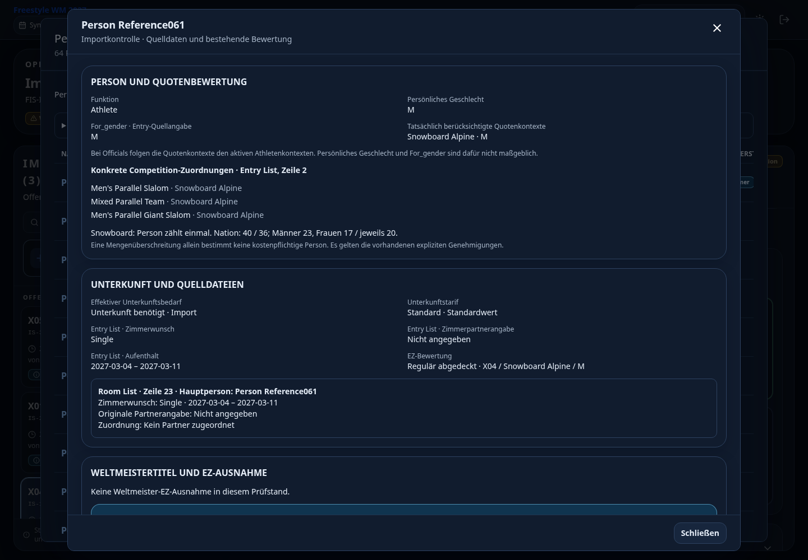
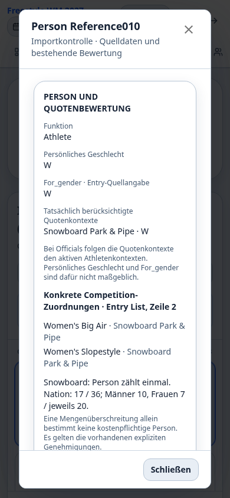

# Importkontrolle: optionale Details statt zusätzlicher Workflow

## Umfang

Darstellungs-PR auf `main` einschließlich PR #342. Keine Migration und keine
Änderung an Parser, Matching, Quotenregeln, Approval-Auswertung, Tarifableitung,
Confirm, Preservation oder Buchungen.

- Personenname öffnet bei Bedarf Details; vorhandene Tabellenspalten bleiben.
- Zähler und Filter trennen bestehende **Importfehler**, **Klärungsbedarf** und
  **Informationen**. Neue Kontrollhinweise erstellen keine Blockaden oder Approvals.
- Details zeigen konkrete Competition-Memberships, bestehende Quotengruppen,
  persönliches Geschlecht, `For_gender`, tatsächliche Quotenkontexte und EZ-Bewertung.
- Entry- und zugeordnete Room-List-Zeilen bleiben getrennt sichtbar: Zeitraum,
  Original-Partnerangabe, vorhandene Partnerzuordnung und Herkunft der effektiven
  Unterkunfts-/Tarifentscheidung.
- Weltmeister-Titelreferenz und Unterkunfts-/EZ-Ausnahme werden ausdrücklich von
  sportlichen Startrechten getrennt. Fehlende Disziplin-Evidence wird benannt.
- Die Athletenquoten-Detailansicht enthält aufklappbare konkrete Wettbewerbe,
  eindeutige Personen und Mehrfachzuordnungen. Staff-Memberships sind keine Starts.

## Datenfluss und Schutz

`backend/import_control.py::build_import_control()` erzeugt rein lesende Anzeigen.
`quota_keys()` und `athlete_quota_contexts()` liefern die vorhandene Quotenzuordnung.
Wettbewerbe und interne Notizen stammen aus bereits request-lokal geladenen Daten
im `ImportReadContext`. Der Projektionshelfer führt keine Datenbankabfrage aus.

`backend/app.py` ergänzt ausschließlich `session.importControl` in Upload- und
aktuellen Session-Detailantworten. Die Projektion gelangt **nicht** in `preview_json`,
`preview.people`, Fingerprints, Change-Pläne oder Approval-Evidence. Die Sessionliste
lädt keine zusätzlichen Anzeigeprojekte. Keine per-Person-HTTP-Requests.

`ImportControl.tsx` zeigt die Daten an; `DataImport.tsx` bindet Dialog, Filter und
bestehende Notiz-API ein. `QuotaOverviewDialog.tsx` ergänzt Wettbewerbsinformationen.
Die Typänderungen dokumentieren vorhandene Previewfelder und die neue Antwort.

Rückfragen verwenden nur die bestehende Sessionhistorie (`NOTE`,
`waitingForNation=false`). Drei Textvorlagen sind **keine Status**. Die Notiz
verändert weder Sessionstatus noch fachliche Bewertung. Bestehende interne
Personennotizen werden angezeigt, nicht überschrieben.

## Fachliche Grenzen

- Hinweise zählen Sachverhalte, nicht zwingend unterschiedliche Personen.
  Mengenüberschreitungen wählen keine kostenpflichtigen Personen aus.
- Nicht gematchte Room-Zeilen bleiben sichtbar, ohne erratene Personenzuordnung.
  Direktsprünge verwenden ausschließlich vorhandene eindeutige Referenzen.
- Leere Room List bedeutet nicht No room. Explizites Entry-No-room und effektiver,
  ggf. manuell festgelegter Bedarf werden getrennt gezeigt.
- Notizen bleiben beim Reimport Session-/Versionshistorie. Keine automatische
  Zuordnung alter Notizen zu ausgetauschten Personen; neue Notizen enthalten
  sichtbaren Namen und vorhandenen Personenschlüssel.
- Archivierte/ersetzte Prüfstände ohne aktuelle Anzeigeprojektion werden nicht
  heimlich neu interpretiert. Fehlende Detailinformationen werden benannt.
- Keine neue sportliche Startrechtsprüfung, Preisberechnung oder Quotenregel.

## Regression

`backend/tests/test_import_control.py` prüft die sieben vorhandenen originalbasierten
anonymisierten Nationenpaare ITA, NZL, ISR, JPN, GER, KOR, USA: Upload, Detailabruf,
NOTE vor/nach Freigabe, Confirm und identischer Reimport. Personen, Memberships,
Sondertarife, EZ-Genehmigungen, Fingerprints, Pläne und gespeicherte Evidence
bleiben unverändert. Vorhandene Referenztests prüfen zusätzlich personengenaue
Memberships. Reine Projektionstests prüfen Partner-Evidence, Quellen,
Weltmeister-Grenzen, Officials-Quotengender und nicht erratene Zuordnungen.

Echter Chromium gegen Flask/PostgreSQL in neuer isolierter Testdatenbank,
ausschließlich anonymisierte Fixtures:

- JPN: 64 Personen, Details, Suche, konkrete Wettbewerbsverteilung.
- Notiz gespeichert und geladen; identischer Status/Digest, `planStale=false`.
- GER: Informationsfilter und Direktsprung; Entry-No-room und leere Room List.
- Desktop 1440×1000 Dark Mode und 390×844 Light Mode; keine horizontale Überbreite
  der Details, Schließen stellt Liste wieder her, Klärungsfilter funktioniert.
- Keine Browserausnahmen. 20 API-Requests im gesamten Test einschließlich Auth,
  Bootstrap, drei Navigationen, Notiz und Kontrollabrufen; kein Request pro Person.

Screenshots zeigen ausschließlich synthetische Personen:

### Abschließende Testresultate

- Backend vollständig: **967 passed**, **1309 subtests passed** (414,42 s).
- Neue Anzeige-/Nationentests plus Import-Performance: **12 passed**.
- Frontend vollständig: **191 passed**; Typecheck und Produktionsbuild erfolgreich.
- Backup-Suite: **33 passed**, **14 subtests passed**.
- `git diff --check`: erfolgreich.
- Bestehende SQL-Budgets unverändert eingehalten: AUS-Reimport-Preview <80,
  Confirm <160 Statements und höchstens 6 Flushes; Recalculation <80,
  Sessionliste mit drei Nationen <125 Statements.
- Bestehende SQLAlchemy-/Datetime-Deprecation-Warnungen bleiben; keine Testfehler.
  Keine neue Migrationsprüfung erforderlich, da kein Schema geändert wird.

## Betrieb

Kein Deployment, produktiver Datenzugriff, Reset oder produktive Migration.
Originaldateien und personenbezogene Referenzberichte werden nicht versioniert.
Keine Änderung an Rollen, Adminbereinigung oder Restore.
